<p align="center">
  
</p>

<h1 align="center">FlowForge</h1>

<p align="center">
  <strong>Open-source workflow automation and AI voice agents that run on PHP shared hosting.</strong><br>
  A self-hosted alternative to n8n, Zapier and Make: connect 1,690 apps on a visual canvas, let AI build workflows from one sentence, and create AI calling agents that answer the phone and book appointments.<br>
  No Docker, no Node.js, no per-task fees. One cron job runs everything.
</p>

<p align="center">
  <a href="LICENSE"></a>
  <a href="https://github.com/DeveloperSarim/FlowForge/releases"></a>
  
  
  
  
  <a href="DEVELOPMENT.md"></a>
</p>

<p align="center">
  <a href="https://developersarim.github.io/FlowForge/#video"><b>Watch the video</b></a> &nbsp;|&nbsp;
  <a href="https://developersarim.github.io/FlowForge/"><b>Documentation</b></a> &nbsp;|&nbsp;
  <a href="#-quick-start"><b>Quick start</b></a> &nbsp;|&nbsp;
  <a href="#-ai-voice-agents-an-ai-receptionist-and-calling-agent"><b>AI voice agents</b></a> &nbsp;|&nbsp;
  <a href="https://github.com/DeveloperSarim/FlowForge/releases"><b>Download</b></a> &nbsp;|&nbsp;
  <a href="#-installation-and-hosting-services"><b>Hosting &amp; services</b></a> &nbsp;|&nbsp;
  <a href="https://github.com/DeveloperSarim/FlowForge/issues"><b>Report a bug</b></a>
</p>

<p align="center">
  <a href="https://developersarim.github.io/FlowForge/#video">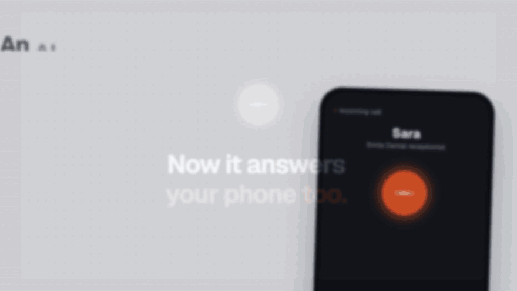</a>
  <br>
  <a href="https://developersarim.github.io/FlowForge/#video"><b>▶ Watch the full 70-second video (with sound)</b></a>
</p>

## ✨ What is FlowForge?

FlowForge is a **self-hosted workflow automation platform** for people who already have ordinary web hosting. Upload it to Hostinger, cPanel, DirectAdmin or any VPS, run the setup wizard, add one cron job, and you have your own automation server with no monthly per-task bill.

- **Connect your apps.** Gmail, Slack, Google Sheets, HubSpot, Shopify, WooCommerce, Stripe, OpenAI, Telegram, WhatsApp and 1,180 more.
- **Build visually or with AI.** Drag steps onto a canvas, or type *"When a Typeform is submitted, add the person to HubSpot and tell #sales on Slack"* and the AI Builder makes it.
- **Any app, even one that isn't listed.** If a service is missing, the AI Builder adds it as a custom app from its API (or you import its OpenAPI file), then builds the workflow with it.
- **Answer the phone with AI.** Build an AI receptionist or calling agent in minutes, test it free in your browser, then give it a real phone number. It books appointments and passes every call (recording, transcript, summary) to your workflows.
- **Runs that recover on their own.** When an app is down or slow, failed runs retry automatically from the step that failed (2 minutes to 6 hours later), so nothing is sent twice. Each workflow has an Auto-retry switch, and each step can retry, keep going or be turned off.
- **Any AI model.** OpenAI, Claude, Gemini, DeepSeek, Qwen, or any OpenAI- or Anthropic-compatible API (OpenRouter, Groq, Ollama…) as a custom provider.
- **Own your data.** Workflows, credentials and run history stay in your own MySQL database. Credentials are encrypted and never sent to the browser.

## 📞 AI voice agents: an AI receptionist and calling agent

Create AI agents that **answer and make phone calls**: a receptionist that books appointments, a caller that qualifies new leads, a reminder line that confirms tomorrow's bookings. No code, and no extra server.

<p align="center">
  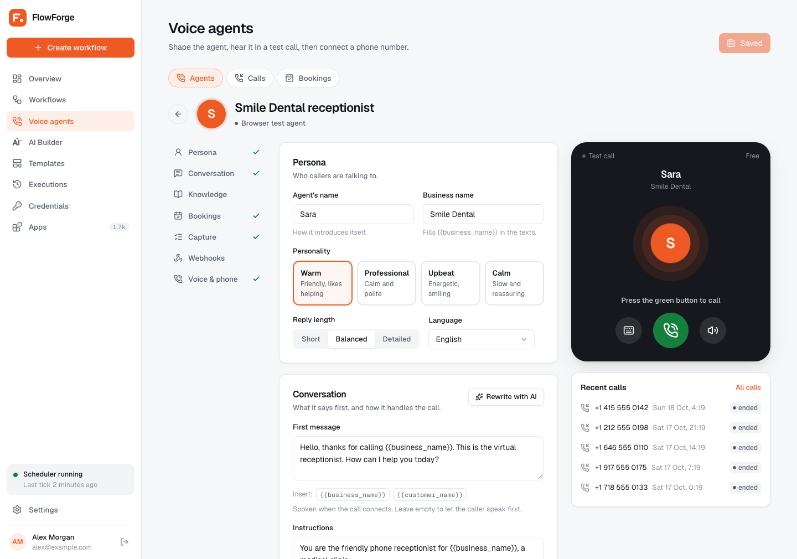
</p>

- **12 ready-made agents**, each with a sample conversation: clinic receptionist, salon booking, restaurant reservations, hotel front desk, car service booking, gym class booking, store order help, lead qualification, appointment reminders, customer support line, real estate inquiries and a feedback survey. Or describe your business and AI writes the agent for you.
- **Agent studio.** Give it a name and a personality (warm, professional, upbeat or calm), what it says first, facts about your business, answers to common questions, what it can book and your opening hours, and the details to capture from every call.
- **Free test calls in your browser.** Press the green button and talk to it with your microphone, or type. It uses your own AI model (Gemini and DeepSeek are free or very cheap), and bookings, transcripts and summaries are saved like real calls.
- **Real phone calls** through [Vapi](https://vapi.ai) or [ElevenLabs](https://elevenlabs.io), both with free tiers to start. FlowForge publishes the agent, its booking tool and your phone number for you.
- **More than 11,000 natural voices** in over 30 languages, including Urdu, Hindi and Arabic. Search the ElevenLabs voice library, filter by language and gender, and play samples before you pick.
- **Behaves like a good receptionist:** short spoken answers, one question at a time, reads the booking back before confirming, and hangs up by itself after goodbye.
- **Everything in one place:** call history with recordings, transcripts, summaries and outcomes, plus a Bookings page.
- **Webhooks:** send every finished call or new booking straight to your own app (Make, Zapier, n8n, your server) as signed JSON, with retries.
- **Connected to your workflows:** "When a voice call ends", "When a caller books" and "Call a phone number". Put bookings in Google Calendar, post call summaries to Slack, or call every new lead automatically.

<table>
  <tr>
    <td width="50%">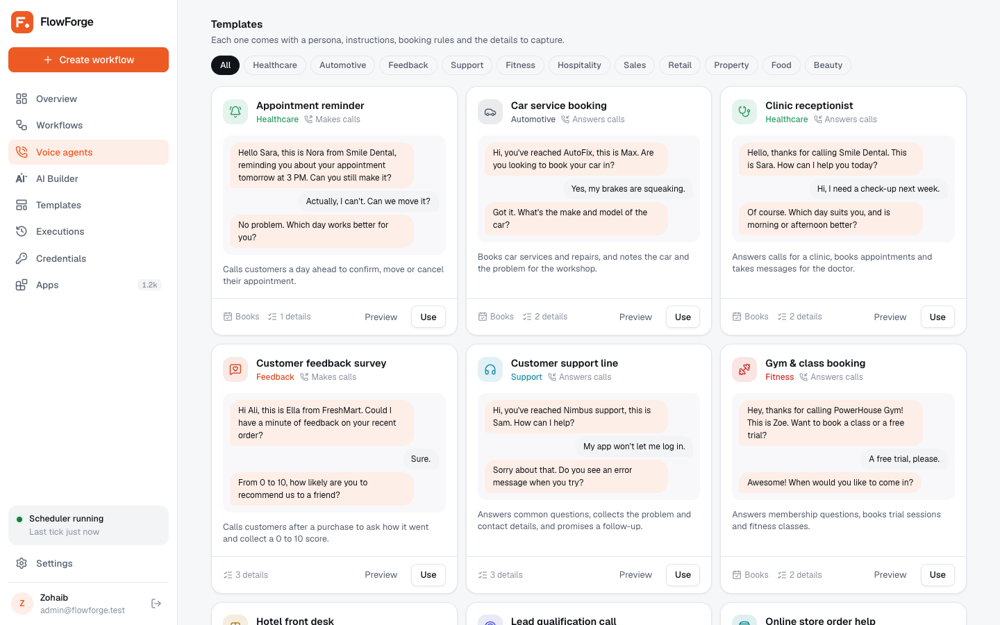<p align="center"><sub>12 templates with sample conversations</sub></p></td>
    <td width="50%">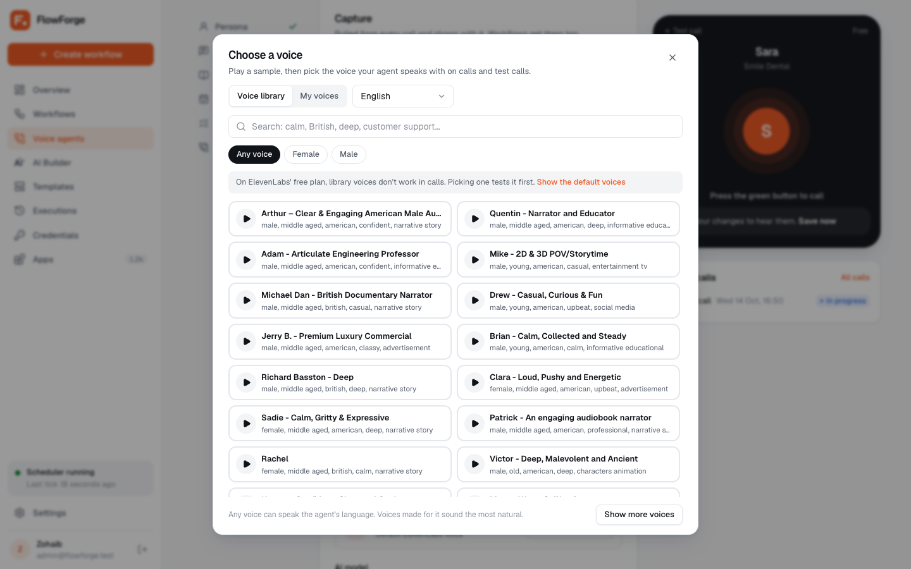<p align="center"><sub>Search 11,000+ ElevenLabs voices by language</sub></p></td>
  </tr>
</table>

## 🧩 Features

<table>
  <tr>
    <td width="33%" valign="top">
      <br>
      <b>Visual workflow builder</b><br>
      <sub>Triggers, actions, If/Else branches and filters on a drag-and-drop canvas, several flows per workflow, right-click menus and copy/paste, with a step editor that maps data by dragging fields.</sub>
    </td>
    <td width="33%" valign="top">
      <br>
      <b>1,690 apps, 8,700 actions</b><br>
      <sub>800 triggers and 54 ready-made templates across 24 categories, plus an HTTP request step for any other API.</sub>
    </td>
    <td width="33%" valign="top">
      <br>
      <b>AI Builder</b><br>
      <sub>Describe a workflow in plain words and it builds, links and explains it. Works with OpenAI, Claude, Gemini, DeepSeek or Qwen, using your own key.</sub>
    </td>
  </tr>
  <tr>
    <td valign="top">
      <br>
      <b>Every kind of trigger</b><br>
      <sub>Webhooks, schedules in plain words ("every weekday at 9:00"), app triggers that watch for new items, manual runs and error triggers.</sub>
    </td>
    <td valign="top">
      <br>
      <b>Step-by-step debugger</b><br>
      <sub>Every run keeps each step's input, output and HTTP request. Retry a run or execute a single step while you build.</sub>
    </td>
    <td valign="top">
      <br>
      <b>Made for shared hosting</b><br>
      <sub>PHP and MySQL only. A setup wizard checks your server and verifies the one cron job that runs every workflow.</sub>
    </td>
  </tr>
  <tr>
    <td valign="top">
      <br>
      <b>Team and permissions</b><br>
      <sub>Invite admins and members, and choose who can view, edit or delete workflows and use the AI Builder.</sub>
    </td>
    <td valign="top">
      <br>
      <b>MCP server for AI agents</b><br>
      <sub>Claude Code, Cursor and VS Code agents can search apps and build, test and run workflows with a personal token.</sub>
    </td>
    <td valign="top">
      <br>
      <b>One-click updates</b><br>
      <sub>Settings shows when a new version is out. One click downloads, verifies and installs it, with a backup and automatic rollback.</sub>
    </td>
  </tr>
  <tr>
    <td valign="top">
      <br>
      <b>Works like an app on phones</b><br>
      <sub>Bottom tab bar, bottom sheets, one-pane step editor, light and dark themes. Add it to your home screen.</sub>
    </td>
    <td valign="top">
      <br>
      <b>Secure by default</b><br>
      <sub>Encrypted credentials, secrets masked in run logs, signed one-click updates, webhook signature checks, no requests to internal addresses, failure and cron-down alerts.</sub>
    </td>
    <td valign="top">
      <br>
      <b>AI voice agents</b><br>
      <sub>AI receptionists and calling agents that book appointments, with free browser test calls and real calls through Vapi or ElevenLabs.</sub>
    </td>
  </tr>
</table>

## 🔌 Integrations

<p align="center">
  &nbsp;
  &nbsp;
  &nbsp;
  &nbsp;
  &nbsp;
  &nbsp;
  &nbsp;
  &nbsp;
  &nbsp;
  
  <br><br>
  &nbsp;
  &nbsp;
  &nbsp;
  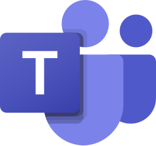&nbsp;
  &nbsp;
  &nbsp;
  &nbsp;
  &nbsp;
  &nbsp;
  
</p>

<p align="center"><sub>…and 1,670 more across AI, CRM, e-commerce, payments, marketing, communication, project management, databases, forms, social media and developer tools.<br>Any app not on the list works through the HTTP request step or its "Make an API call" action.</sub></p>

## 📸 Screenshots

<table>
  <tr>
    <td width="50%">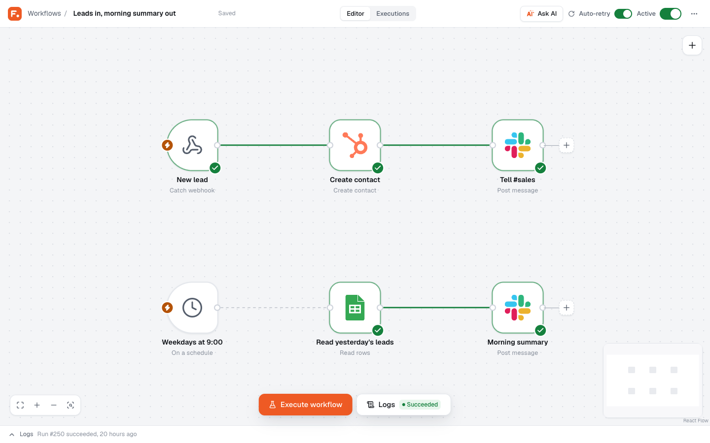<p align="center"><sub>Workflow builder</sub></p></td>
    <td width="50%">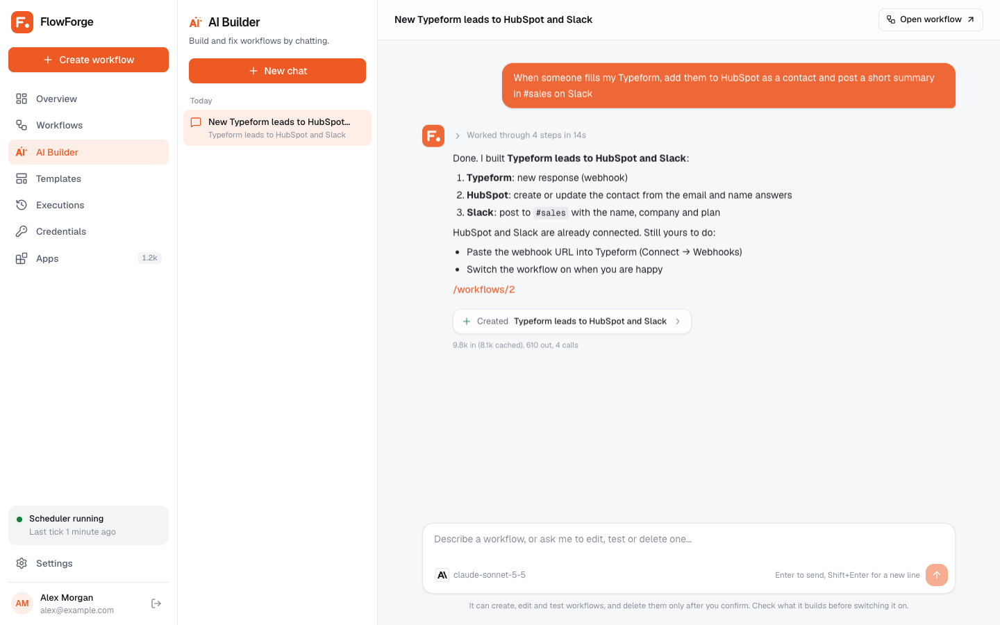<p align="center"><sub>AI Builder</sub></p></td>
  </tr>
  <tr>
    <td>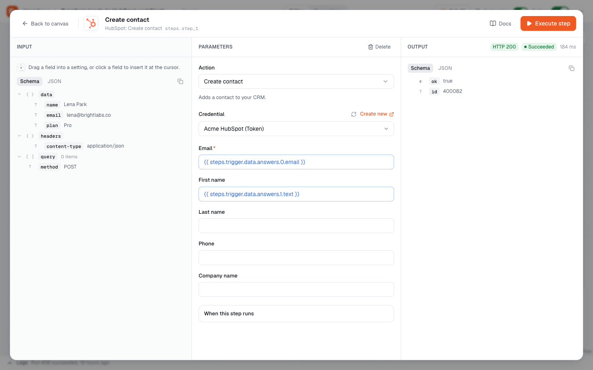<p align="center"><sub>Step editor with drag-to-map data</sub></p></td>
    <td>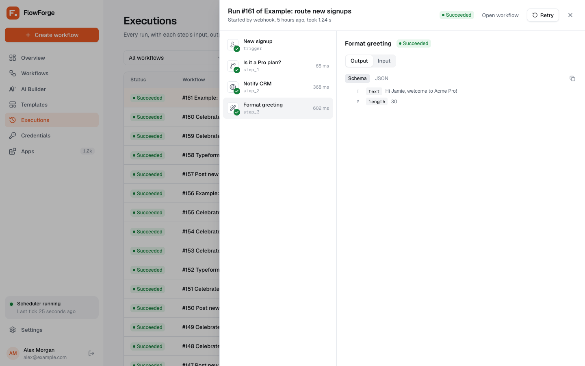<p align="center"><sub>Executions and step debugger</sub></p></td>
  </tr>
</table>

<details>
<summary><b>On a phone</b></summary>
<br>
<p align="center">
  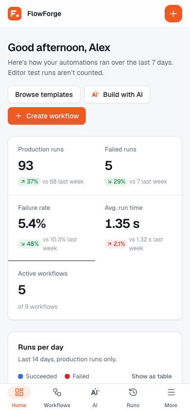&nbsp;
  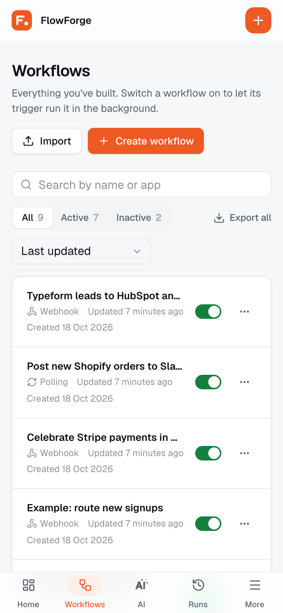&nbsp;
  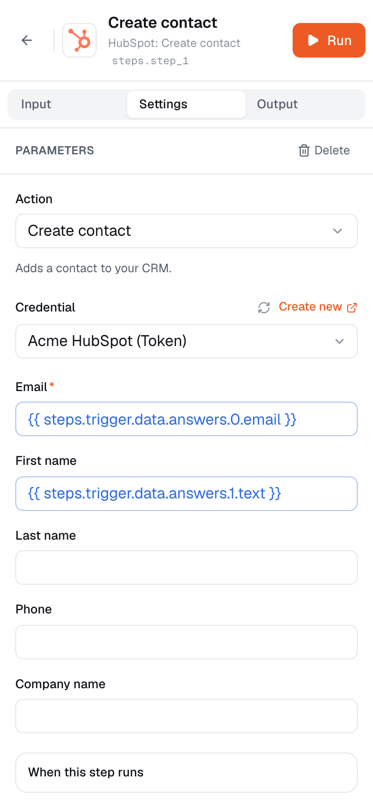&nbsp;
  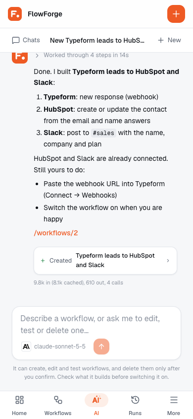
</p>
</details>

## 🚀 Quick start

You need hosting with **PHP 8.2+, MySQL and cron** (every Hostinger and cPanel plan has these). No SSH, Composer or Node.js on the server.

1. **Download** `flowforge-install-x.y.z.zip` from the [latest release](https://github.com/DeveloperSarim/FlowForge/releases).
2. **Create an empty MySQL database** and a user in your hosting panel.
3. **Upload and extract** the zip into your domain's folder (for example `public_html`). If your File Manager times out, also upload `extract-flowforge.php` and open it in your browser.
4. **Open** `https://your-domain.com/install`. The wizard checks your server, connects the database, creates your admin account and sets up email alerts.
5. **Add the cron job** the wizard shows you (or click *Set it up for me*). It turns green within a minute, and you're done.

Step-by-step guides with screenshots: [Hostinger hPanel](https://developersarim.github.io/FlowForge/#hpanel) | [cPanel](https://developersarim.github.io/FlowForge/#cpanel) | [VPS with Nginx](https://developersarim.github.io/FlowForge/#vps) | [Cron job](https://developersarim.github.io/FlowForge/#cron)

<details>
<summary><b>Server requirements</b></summary>
<br>

| Requirement | Details |
| --- | --- |
| PHP | 8.2 or newer, with `pdo_mysql`, `curl`, `mbstring`, `openssl`, `fileinfo`, `gd`, `zip` |
| Database | MySQL 5.7+ or MariaDB 10.3+ |
| Web server | Apache or LiteSpeed with `mod_rewrite`, or Nginx |
| Cron | One job every minute |
| Disk | About 150 MB plus run history |

</details>

## 🆚 How FlowForge compares

| | **FlowForge** | n8n | Zapier | Make |
| --- | :---: | :---: | :---: | :---: |
| Self-hosted on your own server | ✅ | ✅ | ❌ | ❌ |
| Runs on cPanel / hPanel shared hosting | ✅ | ❌ needs a Node.js server | ❌ cloud only | ❌ cloud only |
| OSI-approved open-source license | ✅ AGPL-3.0 | ❌ fair-code | ❌ | ❌ |
| No per-task or per-operation fees | ✅ | ✅ when self-hosted | ❌ | ❌ |
| Built-in AI voice agents (calls, bookings, call history) | ✅ | ➖ through integrations | ➖ through integrations | ➖ through integrations |

<sub>Based on each product's public information as of October 2026.</sub>

## 🤖 AI Builder and MCP

**AI Builder.** Open *AI Builder* in the sidebar and describe what you want. It searches the app catalog, reads each action's settings, saves the workflow, links the data between steps and tells you what's left to fill in. Bring your own key from OpenAI, Anthropic Claude, Google Gemini, DeepSeek or Qwen, or connect any OpenAI- or Anthropic-compatible API as a custom provider (OpenRouter, Groq, Together, Mistral, Ollama, LM Studio, LiteLLM…).

**Custom apps.** When a service isn't in the catalog, the AI Builder builds it as a custom app from the service's documented API (base URL, sign-in, actions and the fields each returns), checks it, and uses it in your workflow. You can also import any OpenAPI (Swagger) file from *Apps → Add a custom app*. Custom apps get their own credentials, live in `storage/` so updates keep them, and only ever call their own API address.

**MCP for AI agents.** Create a token in *Settings → API & MCP*, then connect your agent. For example, Claude Code:

```bash
claude mcp add --transport http flowforge https://your-domain.com/api/mcp \
  --header "Authorization: Bearer YOUR_TOKEN"
```

## 📚 Documentation

The full guide is at **[developersarim.github.io/FlowForge](https://developersarim.github.io/FlowForge/)**:

- [Installation](https://developersarim.github.io/FlowForge/#before-you-start) on Hostinger hPanel, cPanel and VPS, and the [setup wizard](https://developersarim.github.io/FlowForge/#setup-wizard)
- [Your first workflow](https://developersarim.github.io/FlowForge/#first-workflow), [triggers](https://developersarim.github.io/FlowForge/#triggers) and [passing data between steps](https://developersarim.github.io/FlowForge/#data-mapping)
- [Credentials and app connections](https://developersarim.github.io/FlowForge/#credentials), [AI Builder](https://developersarim.github.io/FlowForge/#ai-builder) and [team permissions](https://developersarim.github.io/FlowForge/#team)
- [AI voice agents](https://developersarim.github.io/FlowForge/#voice-agents): [free test calls](https://developersarim.github.io/FlowForge/#voice-free), [real calls with Vapi or ElevenLabs](https://developersarim.github.io/FlowForge/#voice-phone) and [using calls in workflows](https://developersarim.github.io/FlowForge/#voice-workflows)
- [Updating](https://developersarim.github.io/FlowForge/#updating), [backups](https://developersarim.github.io/FlowForge/#backups) and [troubleshooting](https://developersarim.github.io/FlowForge/#troubleshooting)

Developers: architecture, the integration manifest format, local setup and releases are in **[DEVELOPMENT.md](DEVELOPMENT.md)**.

## 💼 Installation and hosting services

FlowForge is free. If you'd rather not set it up or run it yourself, we can help:

| | Service |
| :---: | --- |
| 🛠️ | **Installation** on your Hostinger hPanel, cPanel or VPS, including the database, SSL and cron job |
| ☁️ | **Managed hosting**: we run FlowForge for you, with backups and updates |
| 🧭 | **Setup help**: connecting your apps and building your first workflows |
| 🔧 | **Custom integrations** for apps or APIs that aren't in the catalog yet |

Email **[support@sarimtools.com](mailto:support@sarimtools.com?subject=FlowForge%20services)** with what you need and we'll send you a quote.

## ❓ FAQ

<details>
<summary><b>Is FlowForge really free?</b></summary>
<br>
Yes. It's open source under the AGPL-3.0 license, with no limits on users, workflows, runs or sites. You only pay if you want our installation or hosting services.
</details>

<details>
<summary><b>Do I need a cron job for every workflow?</b></summary>
<br>
No. One cron job, running every minute, runs every schedule, webhook and app trigger.
</details>

<details>
<summary><b>Can I use it for my business or my clients?</b></summary>
<br>
Yes. If you change FlowForge's code and offer the changed version to other people over a network, the AGPL requires you to offer them your source code too.
</details>

<details>
<summary><b>How is it different from n8n?</b></summary>
<br>
n8n needs a Node.js server, usually a VPS or Docker. FlowForge is PHP, so it runs on the shared hosting most websites already use, and it's licensed under an OSI-approved open-source license.
</details>

<details>
<summary><b>What if the app I need isn't in the list?</b></summary>
<br>
Ask the AI Builder to add it as a custom app, or import its OpenAPI file from Apps → Add a custom app. For a single request, the HTTP request step works with any API.
</details>

<details>
<summary><b>Can FlowForge answer phone calls with AI?</b></summary>
<br>
Yes. Voice agents work as an AI receptionist or calling agent: they answer and make calls, answer questions about your business, book appointments and save every call with its recording, transcript and summary. The live call runs on Vapi or ElevenLabs; FlowForge sets everything up and keeps your call history and bookings.
</details>

<details>
<summary><b>Is the AI voice agent free?</b></summary>
<br>
Building agents and test calls in your browser are free; they use your own AI key, and Gemini and DeepSeek are free or very cheap. Real phone calls are billed by Vapi or ElevenLabs, and both have free tiers to start.
</details>

<details>
<summary><b>Which languages can the voice agents speak?</b></summary>
<br>
English, Urdu, Hindi, Arabic, Spanish, French, German, Portuguese, Turkish and many more. ElevenLabs has voices made for each language, and any voice can speak any of them.
</details>

<details>
<summary><b>How fast do webhooks run?</b></summary>
<br>
Within about a minute, on the next cron tick. Test runs in the editor run straight away.
</details>

## 🤝 Contributing

Bug reports, ideas and pull requests are welcome. Please read [CONTRIBUTING.md](CONTRIBUTING.md) and the [Code of Conduct](CODE_OF_CONDUCT.md).

- Found a bug? [Open an issue](https://github.com/DeveloperSarim/FlowForge/issues) with your FlowForge and PHP versions and the steps to reproduce it.
- Want to add an app? Integrations are JSON/YAML manifests, not PHP classes. See [DEVELOPMENT.md](DEVELOPMENT.md).

```bash
git clone https://github.com/DeveloperSarim/FlowForge.git && cd FlowForge
composer install && npm install && npm run build
cd public && php -S 127.0.0.1:8000 ../vendor/laravel/framework/src/Illuminate/Foundation/resources/server.php
# open http://127.0.0.1:8000/install
```

## 🔒 Security

- **Signed updates:** one-click updates install only releases signed with the FlowForge release key (Ed25519) whose checksum matches the download.
- **Webhooks:** optional sender checks (secret header, basic auth, HMAC signatures for GitHub, Shopify and WooCommerce, Stripe and Slack signatures with replay protection), replaceable webhook URLs, and tokens in headers and query strings never stored in run history.
- **Outbound requests:** steps can't reach localhost, private networks or cloud metadata addresses (SSRF protection); VPS installs can allow their own network with `FLOWFORGE_ALLOW_PRIVATE_NETWORK=true`.
- **No double sends:** runs are saved step by step; a write that may already have gone through is never repeated automatically, and payment apps get idempotency keys.

Please report security issues privately to [support@sarimtools.com](mailto:support@sarimtools.com?subject=FlowForge%20security) rather than in a public issue.

## 📄 License

FlowForge is free software under the [GNU Affero General Public License v3.0](LICENSE). App names and logos are trademarks of their owners, used only to identify each integration.

<p align="center"><sub>Built with Laravel, React, React Flow and Tailwind CSS.</sub></p>
